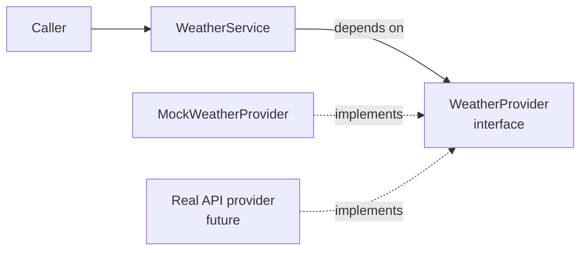

# Weather Service Stub

A mock weather API service module, built with strict Test-Driven Development. It returns predictable forecasts for a set of known cities and specific errors for invalid requests. The service depends on an abstract `WeatherProvider`, so the mock data source can later be replaced by a real weather API without changing the service.

## Setup

Requires Python 3.11+.

```bash
git clone https://github.com/B-Pine/weather-service.git
cd weather-service
python -m venv .venv
.venv\Scripts\activate          # Windows
source .venv/bin/activate       # macOS / Linux
pip install -r requirements.txt
pre-commit install
```

> **Keep the virtual environment activated when committing.** The mypy hook runs the `mypy` installed in the virtual environment.
>
> **Windows:** if mypy is blocked with `WinError 4551`, install its pure-Python build:
> `pip uninstall mypy -y` then `pip install --no-binary mypy mypy==1.11.2`

## Usage

```python
from weather.providers.mock_weather_provider import MockWeatherProvider
from weather.services.weather_service import WeatherService

service = WeatherService(provider=MockWeatherProvider(api_key="demo-key"))

forecast = service.get_forecast("Kigali")
print(forecast)
# Forecast(city='Kigali', temperature_celsius=24.0, condition='Partly cloudy')
```

City names are matched regardless of letter case and surrounding spaces, so `"kigali"` and `"  KIGALI "` both work.

### Known cities

| City | Temperature | Condition |
|---|---|---|
| Kigali | 24.0 °C | Partly cloudy |
| Nairobi | 22.0 °C | Light rain |
| Kampala | 26.0 °C | Thunderstorms |
| Dar es Salaam | 30.0 °C | Sunny |

The only valid API key for the mock provider is `demo-key`.

### Handling errors

```python
from weather.exceptions import CityNotFoundError, InvalidAPIKeyError

try:
    service.get_forecast("Atlantis")
except CityNotFoundError as error:
    print(error)        # City not found: 'Atlantis'
except InvalidAPIKeyError as error:
    print(error)        # Invalid API key
```

| Exception | Raised when |
|---|---|
| `InvalidAPIKeyError` | The API key is not accepted. Checked before the city, like a real API |
| `CityNotFoundError` | No forecast exists for the city, including blank names |

Both inherit from `WeatherServiceError`, so `except WeatherServiceError` catches every service error. The API key is never included in error messages or logs.

### Logging

The module logs every request in a structured `key=value` format but, as a library, does not configure logging itself. To see the log messages:

```python
import logging

logging.basicConfig(level=logging.INFO)
```

```
INFO:weather.services.weather_service:forecast requested city=Kigali
INFO:weather.services.weather_service:forecast returned city=Kigali condition=Partly cloudy
WARNING:weather.providers.mock_weather_provider:city not found city=Atlantis
```

## Architecture



| Component | Responsibility |
|---|---|
| `WeatherService` | The public entry point. Gets forecasts from its provider and logs every request and response |
| `WeatherProvider` | Abstract interface for any source of forecasts |
| `MockWeatherProvider` | Simulates a weather API: checks the API key, then looks up predefined forecasts |
| `Forecast` | Frozen dataclass returned to callers |
| `normalize_city_name` | Shared formatter that makes city lookups ignore case and spaces |

`WeatherService` receives its provider through its constructor and imports only the `WeatherProvider` interface; it does not know the mock exists. A real provider, for example one calling an HTTP weather API, would implement the same interface and plug in without any change to the service. The API key belongs to the provider, because it is sent to the weather API with each request.

## The TDD process

Every behaviour in this project was written test-first, following the Red-Green-Refactor cycle:

1. **Red:** write a test for behaviour that does not exist yet, and confirm it fails for the right reason: the behaviour is missing, not the code broken
2. **Green:** write the minimum code that makes the test pass
3. **Refactor:** improve the structure while every test stays green

The commit history records each stage, using the commit scope:

| Commit prefix | Stage |
|---|---|
| `test(red):` | A failing test |
| `feat(green):` | The minimum code to pass it |
| `refactor:` | Structure improved, behaviour unchanged |
| `test:` | A test that passed immediately (see below) |

For example, the first feature:

```
test(red): add failing test for forecast of a known city
feat(green): return hardcoded forecast for Kigali
test(red): require forecast for a second city
feat(green): look up forecasts by city name
refactor: derive city lookup from the forecast list
```

View the full history with `git log --oneline`.

### Techniques used

- **Shape before behaviour.** Before a red commit, only the empty skeleton the test needs was created (for example, a method raising `NotImplementedError`), so the test fails because of missing behaviour rather than an import error, and the pre-commit type checks still pass.
- **Fake it, then triangulate.** The first green step returned a hardcoded Kigali forecast. A second city in the test then made the fake fail and forced a real lookup.
- **Preparatory refactoring.** Before adding the API key to the constructor, the tests were changed to create the service in one shared fixture, so the change touched one line instead of every test.
- **Expand and contract.** Dependency injection was introduced by first accepting an optional provider (expand), then making it required and removing the old way (contract), so no step broke the existing tests.
- **Characterization tests.** Some tests passed immediately, because existing code already behaved correctly (blank city names, provider errors passing through). These are committed as `test:`, not `test(red):`, so the history stays honest.

### How TDD shaped the design

The architecture was not planned upfront. The first version had the forecast data built into `WeatherService`. A test that needed the service to return data from a different source could not be written with that design, and that test drove the refactor to the `WeatherProvider` interface and dependency injection.

## Testing

```bash
python -m pytest                                                     # run the tests
python -m pytest --cov --cov-report=term-missing --cov-report=html   # with coverage
mypy weather tests                                                   # strict type check
```

**Coverage: 100% across 22 tests** (minimum enforced: 95%). The latest report is in [`docs/coverage-report.txt`](docs/coverage-report.txt), and the HTML report is written to `htmlcov/index.html`.

- `tests/providers` tests the mock provider: known cities, unknown and blank cities, invalid API keys, key-before-city order, and that rejections are logged without revealing the key
- `tests/services` tests the service with a mocked provider (`pytest-mock`, `create_autospec`): delegation, logging, and that provider errors reach the caller unchanged, plus one test with the real mock provider

Black, ruff (including Google-style docstring checks) and mypy in strict mode run on every commit through pre-commit hooks.

## Git workflow

The project uses trunk-based development:

- `main` is the only long-lived branch and is protected: changes arrive only through pull requests
- Work happens on short-lived branches created from `main` (`feat/...`, `refactor/...`, `docs/...`), each merged within a day
- Pull requests use the template in `.github/pull_request_template.md`, including a check that commits follow the TDD cycle
- Pull requests are merged with merge commits, never squashed, so the individual Red-Green-Refactor commits remain visible on `main`

Two branches, `feat/add-kampala` and `feat/add-dar-es-salaam`, were developed in parallel and both changed the same lines. After the first was merged, the conflict was resolved by merging `main` into the second branch, keeping both cities, and running the full test suite on the resolved code before committing.